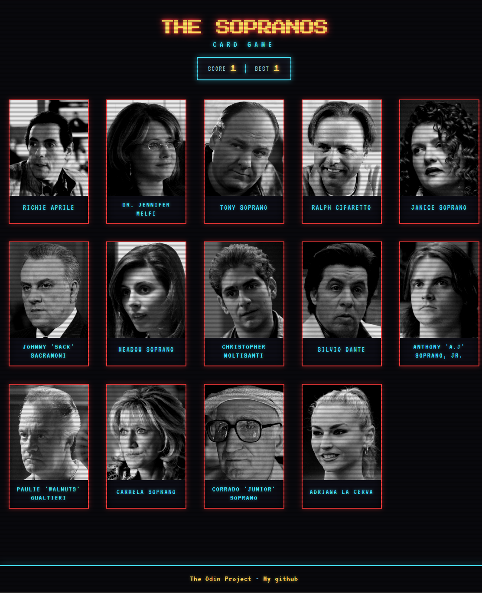

# Sopranos Memory Card

  

A memory card game built with React that uses [TheTVDB API](https://thetvdb.com/series/the-sopranos#castcrew) to fetch images of 12 different Sopranos characters. The goal is to click every card exactly once, but the cards shuffle after each click, so you have to remember what you've already clicked.

This project focuses on React hooks, state management, and consuming data from an external API. It is part of [The Odin Project](https://www.theodinproject.com/) curriculum.

## Features

- Fetches 12 unique Sopranos character images from TheTVDB API
- Cards shuffle randomly after every click
- Score tracking with best score saved across rounds
- Win / lose detection with a victory message
- Responsive grid layout
- Retro arcade-inspired styling

## Built With

- React (hooks: `useState`, `useEffect`)
- JavaScript (ES6+)
- HTML & CSS (Flexbox, Grid, custom properties)
- TheTVDB API
- Vite

## What I Learned

- Managing state with React hooks (`useState`, `useEffect`)
- Fetching and handling data from an external API
- Conditional rendering and event handling in React
- Preventing duplicate clicks and detecting game-over conditions
- Shuffling arrays without mutating state

## How to Play

1. Click any card to reveal it and earn a point.
2. The cards shuffle after every click.
3. Click a card you've already picked and the game ends.
4. Click all 12 cards exactly once to win.

## Credits

- Character images from [TheTVDB](https://thetvdb.com/series/the-sopranos#castcrew)
- Project idea from [The Odin Project](https://www.theodinproject.com/)
